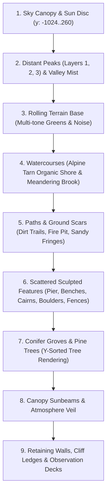

# EXTERIOR ART BIBLE — Forge-Office Environment Overhaul
**Specification Document for Item 2 of FIX-2026-10-06-3**  
**Role:** Exterior Art Director  
**Target Codebase:** `web/render.js` (Canvas 2D Procedural Engine)  
**Palette Profile:** Round-5 High-Summer Alpine Day (`#8FC7EA` sky, `#FFFDE8` sun, `#EAF4DC` horizon)

---

## 1. Executive Vision & Architectural Cohesion

### 1.1 Context & Problem Statement
In Round 4, the initial exterior surrounding the office (alpine tarn, northern peaks, ravine, pine trees, observation decks) was crafted with high charm and artisanal quality. In Round 5, an edge-fill expansion was introduced to prevent black/void edges when the camera zooms out to minimum zoom (`0.6x`). However, this expansion was implemented as a robotic, uniform `#3E6B3F` flat fill for `y >= 260` with a sparse grid of identical pine trees.

At minimum zoom (`0.6x`) on a standard 1080p display, the visible world camera bounds span:
- Width: $1920 / 0.6 = 3200\text{ px}$ (spanning $x \in [-896, 2304]$ when centered on map width $1408\text{ px}$)
- Height: $1080 / 0.6 = 1800\text{ px}$ (spanning $y \in [-260, 1540]$ when centered on map height $1280\text{ px}$)
- Offscreen Vista Buffer: `margin = 1024 px` on all sides $\implies$ rendered canvas spans $x \in [-1024, 2432]$, $y \in [-1024, 2304]$ ($3456 \times 3328\text{ px}$).

This Art Bible defines the high-effort transformation of the entire exterior perimeter into a living, organic alpine wilderness. Every pixel beyond the office walls shares the same artisan hand-crafted quality as the interior, featuring varied terrain textures, organic tree groves, meandering watercourses, walking trails, and 13 distinct scattered points of interest, all driven by a deterministic seeded PRNG.

### 1.2 Coordinate System & Offscreen Vista Canvas
The vista is pre-rendered once onto `this.vistaCanvas` (dimensions $3456 \times 3328\text{ px}$) and blitted via:
```javascript
ctx.drawImage(this.vistaCanvas, -margin, -margin);
```
Inside `bakeMountainVista(map)`, the drawing context is translated by `ctx.translate(margin, margin)`, aligning $(0, 0)$ with the top-left tile of the office map. Coordinates in this specification use this world-space system:
- **Map Origin:** $(0, 0)$, $TILE = 32\text{ px}$. Map footprint: $44 \times 40\text{ tiles} = [0, 1408] \times [0, 1280]\text{ px}$.
- **Office Interior Footprint (Excluded Zone):**
  - Claude / Lobby / OpenCode / Breakroom / Antigravity / Storage: $x \in [32, 1344]$, $y \in [32, 704]$
  - Archives Hallway: $x \in [544, 832]$, $y \in [704, 1248]$
  - Trading Floor: $x \in [960, 1344]$, $y \in [704, 1088]$
  - Central Ravine Void (Natural exterior pocket): $x \in [864, 960]$, $y \in [704, 1088]$
  - Observation Deck A: $x \in [64, 416]$, $y \in [736, 768]$
  - Observation Deck B: $x \in [992, 1344]$, $y \in [1120, 1152]$
- **Full Exterior Domain:** $x \in [-1024, 2432]$, $y \in [-1024, 2304]$.

---

## 2. Color Palette Bible (Round-5 Daylight System)

All colors are calibrated for direct sunlight from the upper right ($x \approx 1013, y \approx 70$), casting subtle soft shadows down and to the left (angle $\approx 220^\circ$, shadow offset: $\Delta x = -3\text{ px}, \Delta y = +4\text{ px}$).

```
                             [SUN #FFFDE8] (Top-Right: x=1013, y=70)
                                   \
                                    \  Sunlight Angle (~220°)
                                     v
   [Highlight / Rim Light] ---> [Object Surface] ---> [Deep Shadow & Drop Shadow]
```

### 2.1 Color Swatch Master Reference

| Category | Swatch Name | Hex Code | Purpose & Application |
| :--- | :--- | :--- | :--- |
| **Sky & Atmosphere** | Azure Zenith | `#8FC7EA` | Top of sky gradient ($y < -200$) |
| | Soft Sky Mid | `#BFE0F2` | Mid sky transition ($y \approx -200 \dots 100$) |
| | Horizon Warm Haze | `#EAF4DC` | Atmospheric light bath at mountain base ($y \approx 100 \dots 260$) |
| | Brilliant Sun | `#FFFDE8` | Solar core disc ($r=14\text{ px}$) |
| | Solar Corona Glow | `rgba(255, 253, 220, 0.95)` | Outer radial falloff to zero at $r=70\text{ px}$ |
| | Cirrus White | `rgba(255, 255, 255, 0.32)` | Wispy drifting cloud strata |
| **Distant Crests** | Snow Crest (Layer 1) | `#9FB4D8` | High alpine distant peaks, airy blue-lilac |
| | Snow / Quartz Frost | `rgba(255, 255, 255, 0.70)` | Sun-facing mountain summit highlights |
| | Mid Massif (Layer 2) | `#7496B2` | Intermediate crags and rocky ridges |
| | Pine Spire Ridge (L3) | `#466A52` | Near mountain ridge sawtooth conifers |
| | Valley Mist Veil | `rgba(235, 245, 255, 0.35)` | Atmospheric mist band across $y \in [130, 190]$ |
| **Terrain Greens** | Lush Valley Grass | `#528246` | Southwest tarn basin & low wetland borders |
| | Sunlit Warm Meadow | `#5D8C4E` | East & southeast sunny rolling pasture base |
| | Golden Grass Crest | `#6E9B56` | Sunlit knoll tops & meadow highlights |
| | Base Alpine Meadow | `#4E7C42` | Primary rolling ground plane across northwest |
| | Shaded Pine Undergrowth| `#365C37` | Forest floor underneath dense conifer groves |
| | Deep Canopy Shadow | `#2D4F30` | Core root-zone under pine clusters |
| | High Upland Turf | `#6B8E4E` | Western boulder field dry alpine turf |
| **Soils & Trails** | Packed Dirt Trail | `#7A6952` | Center of walking trails & worn paths |
| | Sunny Trail Gravel | `#8C7B62` | Trail border & gravel highlights |
| | Trail Fringed Turf | `#9B8C74` | Worn grass transitions at trail perimeter |
| | Rich Humus / Loam | `#5A4A38` | Exposed earthy patches, roots, fire pit ring |
| | Deep Loam Crevice | `#4B3B2C` | Shaded cutouts & soil depression shadows |
| | River Sand / Shore | `#C2B28F` | Tarn gravelly beach & stream shore pebbles |
| **Water & Brook** | Deep Tarn Basin | `#2D5E7B` | Deepest core of alpine lake |
| | Tarn Midwater | `#3D7699` | Ambient body water of tarn |
| | Sunlit Shallows | `#4C86A8` | Cascading brook & lake littoral zone |
| | Aqua Littoral Fringe | `#5A96A6` | Organic shoreline edge transition |
| | Shore Reed Green | `#3A8253` | Lily pads and aquatic vegetation |
| | Water Riffle Foam | `rgba(240, 252, 255, 0.75)` | Brook white-water edges & cascade splash |
| **Rock & Granite** | Glacial Granite Face | `#4E5560` | River rocks, boulders, cairn base stones |
| | Weathered Rock Body | `#6A737D` | Exposed highland boulders & rock ledges |
| | Sunlit Rim Highlight | `#8B95A5` | Upper-right granite specular edge |
| | Crevice Rock Shadow | `#363C44` | Ground contact shadow & stone fissure |
| | Rock Lichen / Moss | `#3A6248` | Moss glaze cap on upper boulder shoulders |
| **Woodcraft** | Hewn Cedar Planks | `#634533` | Observation deck & pier decking base |
| | Weathered Timber Top | `#855F47` | Dock edge boards & bench slats |
| | Split-Rail Fence Bark | `#4E3B2C` | Rustic log rails & trail post uprights |
| | Sunlit Wood Grain | `#9E7758` | Top wood plank highlights |
| | Deep Timber Joint | `#302016` | Wood undersides, pilings, and mortise joins |

---

## 3. Terrain Zones & Biome Map

The exterior is structured into 6 distinct, interconnected biomes. Instead of uniform fills, each zone uses organic patches generated by multi-layered mathematical noise and seeded clusters.

```
       [-1024, -1024]                                  [2432, -1024]
       +-----------------------------------------------------------+
       |   ZONE A: NORTH VISTA PEAKS & PINE RIDGE FOOTHILLS        |
       |   Sky, Cirrus, Peak Layers 1-3, Foothill Rolling Ridges   |
   y=0 + - - - - - - - - - - - - - - - - - - - - - - - - - - - - - + y=0
       | ZONE B: HIGHLAND     |  [OFFICE BUILDING]  | ZONE E:       |
       | MEADOW & BOULDER     |  (Claude, OpenCode, | SUNNY PASTURE |
       | FIELD                |   Antigravity,      | & WINDING     |
       | Upland dry turf,     |   Lobby, Breakroom) | TRAILS        |
       | erratics, cairns,    +---------------------+ Dirt paths,   |
       | dwarf pines          | T.FLOOR | RAVINE(D) | split-rail    |
 y=700 + - - - - - - - - - - -+---------+ Meander   | fence,        |
       | ZONE C: SW TARN & WETLAND      | Brook,    | golden crests |
       | Wobble shoreline, sand fringe, | Stepping  |               |
       | rustic dock, reeds, lily pads, | Stones    |               |
       | fire pit clearing, picnic spot |           |               |
y=1280 + - - - - - - - - - - - - - - - -+ - - - - - + - - - - - - - + y=1280
       |   ZONE F: SOUTHERN EXPANSION & ROLLING MEADOW VALLEYS     |
       |   Layered aerial ridges, dense forest groves, trail ends  |
       +-----------------------------------------------------------+
       [-1024, 2304]                                   [2432, 2304]
```

### Zone A: North Vista Mountain Foothills ($x \in [-1024, 2432], y \in [-1024, 260]$)
- **Character:** Majestic alpine panorama directly visible through the northern picture windows of Claude Office ($y=1, x \in [14, 29]$), OpenCode Studio ($x \in [6, 7]$), and Antigravity Lab ($x \in [36, 38]$).
- **Stratification:**
  1. Sky gradient: $y \in [-1024, 260]$, `#8FC7EA` $\to$ `#BFE0F2` $\to$ `#EAF4DC`.
  2. Sun Disc: center $(1013, 70)$, corona radius $70\text{ px}$, inner core $14\text{ px}$ `#FFFDE8`.
  3. Cirrus clouds: 5 soft horizontal ellipses with slight tilt ($-0.05 \dots 0.04\text{ rad}$).
  4. Peak 1 (Distant snow crests): `#9FB4D8`, base at $y=260$, jagged summits peaking at $y=40 \dots 65$. Snow highlights in `rgba(255,255,255,0.70)`.
  5. Peak 2 (Mid massif): `#7496B2`, intermediate ridges peaking at $y=75 \dots 95$.
  6. Peak 3 (Pine spire ridge): `#466A52`, high-frequency sawtooth ridge peaking at $y=135 \dots 165$.
  7. Valley Mist: linear gradient across $y \in [130, 190]$, `rgba(235, 245, 255, 0.35)`.
  8. Foothill Rolling Meadow Crest: smooth rolling transition across $y \in [180, 260]$ in `#4E7C42` with shaded pine clusters framing the building's north retaining wall.

### Zone B: West / Northwest Highland Meadow & Boulder Field ($x \in [-1024, 0], y \in [0, 720]$)
- **Character:** Exposed upland plateau battered by mountain winds. Firmer, drier turf with outcropping bedrock.
- **Base Color:** `#6B8E4E` (high upland turf) blended with `#4E7C42`.
- **Procedural Patches:** 8–12 irregular rock outcrops and coarse gravel patches (`#5A626E` and `#7A6952`).
- **Flora & Scatter:** Dwarf weathered pines (scale $0.70 \dots 0.85$), scattered glacial boulders (Feature 3), stone cairns (Feature 7), and weathered alpine bench (Feature 11).

### Zone C: Southwest Alpine Tarn & Wetland Sanctuary ($x \in [-1024, 512], y \in [700, 2304]$)
- **Character:** Tranquil glacial tarn immediately south of Break Room's observation deck ($y=23$). Lush, hydric soils, wetland grasses, calm reflective waters.
- **Base Terrain:** `#528246` (lush valley green).
- **The Alpine Tarn (Organic Multi-Frequency Boundary):**
  - Tarn Center: $C_x = 256\text{ px}$ ($8 \times TILE$), $C_y = 992\text{ px}$ ($31 \times TILE$).
  - Base Radii: $R_x = 220\text{ px}$, $R_y = 145\text{ px}$.
  - Organic Wobble Formula (60 discrete perimeter points):
    $$r(\theta) = 1.0 + 0.08\sin(3\theta + 0.4) + 0.05\cos(5\theta - 0.2) + 0.03\sin(8\theta + 1.1)$$
    $$\text{Shoreline: } x(\theta) = C_x + R_x \cdot r(\theta)\cos\theta, \quad y(\theta) = C_y + R_y \cdot r(\theta)\sin\theta$$
  - **Shoreline Transition Layers (Back-to-Front):**
    1. *Pebbled Beach / Sand Fringe:* $R_{x,\text{sand}} = R_x + 18\text{ px}, R_{y,\text{sand}} = R_y + 14\text{ px}$ filled with `#A89874` and `#C2B28F`.
    2. *Shallow Littoral Water:* Outline stroke $8\text{ px}$ `#5A96A6` (aqua fringe).
    3. *Tarn Deep Water Basin:* Radial gradient centered at $(C_x - 30, C_y - 20)$:
       - `0.0`: `#2D5E7B` (abyssal blue)
       - `0.55`: `#3D7699` (mid alpine blue)
       - `0.85`: `#4C86A8` (sunlit azure)
       - `1.0`: `#5A96A6` (littoral boundary)
    4. *Sunlight Reflection Sheen:* 45-degree diagonal wash with `rgba(255, 255, 230, 0.28)`.
- **Water Features:** Rustic Wooden Dock (Feature 1) projecting from northern shoreline, Lily pads, Cattail clumps (Feature 5), Shoreline boulders.
- **Surrounding Clearing:** Stone Fire Pit with Log Benches (Feature 2) situated at $(x = -60, y = 1120)$ in a sheltered meadow hollow.

### Zone D: Central Ravine Meandering Brook ($x \in [840, 1000], y \in [704, 2304]$)
- **Character:** A stony mountain stream originating in the cleft between the Archives hallway ($x \in [17, 26]$) and Trading Floor ($x \in [30, 42]$), tumbling southward toward the distant valley.
- **Meander Equation (Continuous centerline $X_c(y)$):**
  $$X_c(y) = 912 + 28\sin((y - 704) \cdot 0.012) + 14\cos((y - 704) \cdot 0.025)$$
  $$W_{\text{channel}}(y) = 52 + 10\sin((y - 704) \cdot 0.018)$$
- **Bed Stratification:**
  1. *Stony Ravine Trench:* Width $W_{\text{trench}} = W_{\text{channel}} + 36\text{ px}$, filled with dark gorge stone `#363C44`.
  2. *Gravel Bank Margins:* Pebble fringe in `#4E5560` and `#5A4A38`.
  3. *Meandering Watercourse:* Filled with `#4C86A8` and highlighted with foam ribbons `rgba(240, 252, 255, 0.70)`.
  4. *Stepping Stones (Feature 10):* 5 rounded river boulders placed across the brook at $y \approx 940\text{ px}$.

### Zone E: East / Southeast Sunny Pasture & Walking Trails ($x \in [1344, 2432], y \in [0, 2304]$)
- **Character:** Wide, warm, sun-drenched meadows. Gently undulating hills, open clearings, wildflowers, walking trails.
- **Base Terrain:** Warm sunlit green `#5D8C4E` with organic patches of golden crest grass `#6E9B56`.
- **Walking Trails (Branching Procedural Dirt Paths):**
  - *Main Trail:* Emerges from south of Observation Deck B ($(x = 1168, y = 1160)$), meanders southeast toward $(x = 2100, y = 1950)$.
  - *North Trail:* Connects east door of Antigravity Lab ($(x = 1376, y = 240)$) outward to the eastern ridge.
  - *Path Construction:* Width $20\text{ px}$ `#7A6952` center, with $6\text{ px}$ `#8C7B62` edges and dithered grass border `#9B8C74`.
- **Pasture Elements:** Rustic split-rail fences (Feature 8), wooden trail signposts (Feature 6), dense wildflower carpets (Feature 4).

### Zone F: Southern Expansion & Aerial Horizon ($y \in [1280, 2304]$)
- **Character:** Deep rolling vistas seen only at wide zoom. Layered ridges receding with atmospheric perspective.
- **Aerial Falloff:** To represent depth, terrain features at $y > 1700$ subtly blend with horizon haze:
  $$\text{Atmospheric Veil: } \text{Linear gradient from } y = 1600 \text{ to } y = 2304 \text{ of } \text{rgba}(234, 244, 220, 0.22)$$
- Ridge bands in `#4E7C42` and `#3E6B3F` create overlapping horizon waves with pine silhouette treelines.

---

## 4. Scattered Small Features Catalog (13 Artisan Sculpted Elements)

Every feature is procedurally rendered using Canvas 2D primitives. No external images are loaded. All elements respect the sun angle (top-right, casting shadow to bottom-left).

```
   +---------------------------------------------------------------------------------+
   |                                FEATURE ROSTER                                   |
   |  1. Rustic Wooden Dock           7. Balanced Stone Cairn                        |
   |  2. Stone Fire Pit & Benches     8. Rustic Split-Rail Fence Remnant             |
   |  3. Mossy Glacial Erratics       9. Fallen Cedar Trunk & Fungi                  |
   |  4. 4-Species Wildflower Carpet  10. Brook Stepping Stones                      |
   |  5. Wetland Cattails & Reeds     11. Secluded Mountain Vista Bench              |
   |  6. Wooden Directional Signpost  12. Ethereal Canopy Sunbeams                   |
   |                                  13. Forest Fairy Ring (Amanita)                |
   +---------------------------------------------------------------------------------+
```

---

### Feature 1: Rustic Wooden Pier / Dock
- **Location:** Southwest Tarn northern shore, extending into the water at $(x = 220, y = 880)$.
- **Dimensions:** Length $64\text{ px}$, Width $24\text{ px}$, extending southward ($270^\circ$).
- **Canvas Recipe:**
```javascript
function drawRusticDock(ctx, x, y) {
  ctx.save();
  // 1. Water shadow under dock
  ctx.fillStyle = 'rgba(15, 30, 40, 0.45)';
  ctx.fillRect(x - 14, y, 28, 68);

  // 2. Heavy wooden support pilings (4 pilings in water)
  const pilings = [
    { px: x - 10, py: y + 20 }, { px: x + 10, py: y + 20 },
    { px: x - 10, py: y + 56 }, { px: x + 10, py: y + 56 }
  ];
  pilings.forEach(p => {
    ctx.fillStyle = '#261A12'; // Waterlogged wood
    ctx.beginPath();
    ctx.arc(p.px, p.py + 4, 3.5, 0, Math.PI * 2);
    ctx.fill();
    ctx.fillStyle = '#4A3423';
    ctx.fillRect(p.px - 3, p.py - 6, 6, 10);
    // Water ripple ring around piling
    ctx.strokeStyle = 'rgba(210, 240, 255, 0.4)';
    ctx.lineWidth = 1;
    ctx.strokeRect(p.px - 5, p.py + 2, 10, 4);
  });

  // 3. Main stringers / support beams
  ctx.fillStyle = '#3E2A1C';
  ctx.fillRect(x - 11, y, 4, 64);
  ctx.fillRect(x + 7, y, 4, 64);

  // 4. Individual weathered deck planks (10 cross planks)
  for (let i = 0; i < 10; i++) {
    const py = y + i * 6.2;
    const plankW = 26 + ((i % 3) * 1.5);
    const px = x - plankW / 2;
    // Plank base
    ctx.fillStyle = (i % 2 === 0) ? '#6E4D34' : '#63452E';
    ctx.fillRect(px, py, plankW, 5.2);
    // Plank top highlight
    ctx.fillStyle = '#856043';
    ctx.fillRect(px, py, plankW, 1.2);
    // Nail heads
    ctx.fillStyle = '#1D140D';
    ctx.fillRect(px + 3, py + 2, 1, 1.2);
    ctx.fillRect(px + plankW - 4, py + 2, 1, 1.2);
  }

  // 5. Mooring bollard & coiled rope at dock end
  ctx.fillStyle = '#2A1C12';
  ctx.fillRect(x + 7, y + 58, 4, 6);
  ctx.fillStyle = '#8B7355'; // Coiled rope
  ctx.beginPath();
  ctx.arc(x + 7, y + 58, 3, 0, Math.PI * 2);
  ctx.stroke();

  ctx.restore();
}
```

---

### Feature 2: Stone Fire Pit with Split-Log Benches
- **Location:** Southwest Meadow clearing at $(x = -60, y = 1120)$ and Southeast grove at $(x = 1820, y = 1450)$.
- **Dimensions:** Fire pit radius $14\text{ px}$; Benches span radius $32\text{ px}$.
- **Canvas Recipe:**
```javascript
function drawStoneFirePit(ctx, x, y) {
  ctx.save();
  // 1. Scorch mark / soot ground
  const sootGrad = ctx.createRadialGradient(x, y, 2, x, y, 22);
  sootGrad.addColorStop(0.0, 'rgba(255, 20, 18, 0.70)');
  sootGrad.addColorStop(0.5, 'rgba(45, 38, 32, 0.40)');
  sootGrad.addColorStop(1.0, 'rgba(45, 38, 32, 0.0)');
  ctx.fillStyle = sootGrad;
  ctx.beginPath();
  ctx.arc(x, y, 22, 0, Math.PI * 2);
  ctx.fill();

  // 2. Ash and charcoal center
  ctx.fillStyle = '#221F1E';
  ctx.beginPath();
  ctx.arc(x, y, 8, 0, Math.PI * 2);
  ctx.fill();
  ctx.fillStyle = '#6E6662'; // Ash gray specks
  ctx.fillRect(x - 3, y - 2, 6, 4);

  // 3. Ring of 10 river stones
  for (let i = 0; i < 10; i++) {
    const angle = (i / 10) * Math.PI * 2;
    const sx = x + Math.cos(angle) * 11.5;
    const sy = y + Math.sin(angle) * 11.5;
    // Stone shadow
    ctx.fillStyle = '#20242B';
    ctx.beginPath();
    ctx.arc(sx - 1, sy + 1, 3.8, 0, Math.PI * 2);
    ctx.fill();
    // Stone body
    ctx.fillStyle = (i % 2 === 0) ? '#5A626E' : '#4E5560';
    ctx.beginPath();
    ctx.arc(sx, sy, 3.5, 0, Math.PI * 2);
    ctx.fill();
    // Sunlit highlight
    ctx.fillStyle = '#7E8796';
    ctx.beginPath();
    ctx.arc(sx + 0.8, sy - 0.8, 1.8, 0, Math.PI * 2);
    ctx.fill();
  }

  // 4. Two split-log benches (North and West arc)
  // North Bench
  drawLogBench(ctx, x, y - 26, 28, 7, 0);
  // West Bench
  drawLogBench(ctx, x - 26, y, 7, 28, Math.PI / 2);

  ctx.restore();
}

function drawLogBench(ctx, bx, by, w, h, rot) {
  ctx.save();
  ctx.translate(bx, by);
  // Drop shadow
  ctx.fillStyle = 'rgba(20, 25, 20, 0.35)';
  ctx.fillRect(-w/2 - 2, -h/2 + 3, w, h);
  // Hewn log body
  ctx.fillStyle = '#5A3E28';
  ctx.fillRect(-w/2, -h/2, w, h);
  // Smooth seat face
  ctx.fillStyle = '#825C3D';
  ctx.fillRect(-w/2 + 1, -h/2 + 1, w - 2, h - 3);
  // Wood grain streak
  ctx.fillStyle = '#9C704C';
  ctx.fillRect(-w/2 + 4, -h/2 + 2, w - 8, 1);
  ctx.restore();
}
```

---

### Feature 3: Mossy Glacial Erratics / Boulders
- **Location:** Scattered throughout Zone B (Highlands), Zone C (Tarn fringes), and Zone E (Pastures).
- **Dimensions:** Radius varies from $8\text{ px}$ to $22\text{ px}$.
- **Visual Design:** Multi-faceted polygonal silhouette, sunlit specular upper-right facet, moss cap (`#3A6248`), dark ground contact shadow.
- **Canvas Recipe:**
```javascript
function drawGlacialBoulder(ctx, x, y, r, seed = 1) {
  ctx.save();
  // 1. Soft contact shadow (cast to bottom-left)
  ctx.fillStyle = 'rgba(20, 30, 25, 0.45)';
  ctx.beginPath();
  ctx.ellipse(x - r * 0.25, y + r * 0.35, r * 1.1, r * 0.55, -0.15, 0, Math.PI * 2);
  ctx.fill();

  // 2. Sculpted irregular polygonal rock body
  const points = [];
  const sides = 7;
  for (let i = 0; i < sides; i++) {
    const angle = (i / sides) * Math.PI * 2;
    const wobble = 1.0 + (((seed * 37 + i * 19) % 10) - 5) * 0.04;
    points.push({
      x: x + Math.cos(angle) * r * wobble,
      y: y + Math.sin(angle) * (r * 0.75) * wobble
    });
  }

  // Main rock fill
  ctx.fillStyle = '#4E5560';
  ctx.beginPath();
  ctx.moveTo(points[0].x, points[0].y);
  points.forEach(p => ctx.lineTo(p.x, p.y));
  ctx.closePath();
  ctx.fill();

  // 3. Shaded crevice bottom facet
  ctx.fillStyle = '#363C44';
  ctx.beginPath();
  ctx.moveTo(x - r, y);
  ctx.lineTo(x, y + r * 0.65);
  ctx.lineTo(x + r * 0.8, y + r * 0.2);
  ctx.lineTo(x, y);
  ctx.closePath();
  ctx.fill();

  // 4. Sunlit facet (top-right highlight)
  ctx.fillStyle = '#737B8A';
  ctx.beginPath();
  ctx.moveTo(x - r * 0.2, y - r * 0.65);
  ctx.lineTo(x + r * 0.85, y - r * 0.3);
  ctx.lineTo(x + r * 0.4, y + r * 0.1);
  ctx.lineTo(x - r * 0.1, y - r * 0.1);
  ctx.closePath();
  ctx.fill();

  // 5. Moss velvet cap on top ridge
  ctx.fillStyle = '#3A6248';
  ctx.beginPath();
  ctx.ellipse(x + r * 0.1, y - r * 0.35, r * 0.65, r * 0.3, 0.1, Math.PI, Math.PI * 2);
  ctx.fill();
  ctx.fillStyle = '#4E8058'; // Bright moss highlight
  ctx.fillRect(x, y - r * 0.4, r * 0.4, 2);

  ctx.restore();
}
```

---

### Feature 4: Four-Species Wildflower Carpet
- **Distribution:** Organic sweeps across Zone C (Wetlands) and Zone E (Sunny Pastures).
- **Species System:**
  1. **Alpine Columbine (`#5E6AD2` violet / `#8C7CE6` lilac):** 5-pointed nodding blossom with pale center.
  2. **Golden Buttercup (`#FFD13B` golden yellow / `#F6AD55` core):** Cup-shaped cupule with specular dot.
  3. **Mountain Edelweiss / Daisy (`#FFFFFF` crisp white petals / `#ECC94B` yellow button):** Distinct radiating ray florets.
  4. **Alpine Poppy (`#FF5E5B` vermilion coral / `#4A2020` stamen):** Vibrant 4-lobed cup.
- **Canvas Recipe:**
```javascript
function drawWildflowerCluster(ctx, x, y, count, species, seed) {
  ctx.save();
  for (let i = 0; i < count; i++) {
    const fx = x + (((seed * 31 + i * 47) % 32) - 16);
    const fy = y + (((seed * 59 + i * 23) % 24) - 12);

    // Stem & leaf speck
    ctx.fillStyle = '#386333';
    ctx.fillRect(fx, fy, 1, 3);

    if (species === 0) { // Columbine
      ctx.fillStyle = (i % 2 === 0) ? '#5E6AD2' : '#8C7CE6';
      ctx.beginPath();
      ctx.arc(fx, fy - 1, 2.2, 0, Math.PI * 2);
      ctx.fill();
      ctx.fillStyle = '#FFF8D6';
      ctx.fillRect(fx - 0.5, fy - 1.5, 1, 1);
    } else if (species === 1) { // Buttercup
      ctx.fillStyle = '#FFD13B';
      ctx.beginPath();
      ctx.arc(fx, fy - 1, 2.0, 0, Math.PI * 2);
      ctx.fill();
      ctx.fillStyle = '#E28E2B';
      ctx.fillRect(fx - 0.5, fy - 1.5, 1, 1);
    } else if (species === 2) { // Edelweiss / Daisy
      ctx.fillStyle = '#FFFFFF';
      ctx.beginPath();
      ctx.arc(fx, fy - 1, 2.4, 0, Math.PI * 2);
      ctx.fill();
      ctx.fillStyle = '#ECC94B';
      ctx.beginPath();
      ctx.arc(fx, fy - 1, 1.0, 0, Math.PI * 2);
      ctx.fill();
    } else { // Poppy
      ctx.fillStyle = '#FF5E5B';
      ctx.beginPath();
      ctx.arc(fx, fy - 1, 2.5, 0, Math.PI * 2);
      ctx.fill();
      ctx.fillStyle = '#3D1A1A';
      ctx.fillRect(fx - 0.5, fy - 1.5, 1, 1);
    }
  }
  ctx.restore();
}
```

---

### Feature 5: Wetland Cattails & Tall Reed Clumps
- **Location:** Fringes of the Southwest Tarn and banks of the Central Ravine Brook.
- **Dimensions:** Width $16\text{ px}$, Height $24\text{ px}$.
- **Canvas Recipe:**
```javascript
function drawCattailClump(ctx, x, y, seed = 1) {
  ctx.save();
  // 1. Shaded wet soil base
  ctx.fillStyle = 'rgba(20, 35, 20, 0.35)';
  ctx.beginPath();
  ctx.ellipse(x, y + 2, 10, 4, 0, 0, Math.PI * 2);
  ctx.fill();

  // 2. Arching green reed blades (6 blades)
  ctx.lineWidth = 1.2;
  const blades = [-7, -4, -1, 2, 5, 8];
  blades.forEach((dx, idx) => {
    const tipCurve = dx * 1.4 + ((seed * 11 + idx * 7) % 5 - 2);
    ctx.strokeStyle = (idx % 2 === 0) ? '#4A7C3D' : '#3B6330';
    ctx.beginPath();
    ctx.moveTo(x + dx * 0.6, y);
    ctx.quadraticCurveTo(x + dx, y - 10, x + dx + tipCurve, y - 18 - (idx % 3) * 3);
    ctx.stroke();
  });

  // 3. Cattail spikes (2-3 velvety brown cylinders on central stalks)
  const spikes = [{ dx: -2, h: 20 }, { dx: 3, h: 22 }];
  spikes.forEach(s => {
    // Rigid upright stalk
    ctx.strokeStyle = '#2F4F24';
    ctx.lineWidth = 1.0;
    ctx.beginPath();
    ctx.moveTo(x + s.dx, y);
    ctx.lineTo(x + s.dx, y - s.h);
    ctx.stroke();

    // Brown cattail sausage
    ctx.fillStyle = '#5A361D';
    ctx.fillRect(x + s.dx - 1.5, y - s.h + 3, 3, 7.5);
    // Sunlit spike edge
    ctx.fillStyle = '#7A4D2E';
    ctx.fillRect(x + s.dx, y - s.h + 3, 1.2, 7.5);
    // Top spike tip
    ctx.fillStyle = '#2F4F24';
    ctx.fillRect(x + s.dx - 0.5, y - s.h, 1, 3);
  });

  ctx.restore();
}
```

---

### Feature 6: Wooden Directional Trail Signpost
- **Location:** Forks in the walking paths: $(x = 1380, y = 780)$ and $(x = 1850, y = 1200)$.
- **Dimensions:** Post height $26\text{ px}$; sign arms span $18\text{ px}$.
- **Canvas Recipe:**
```javascript
function drawTrailSignpost(ctx, x, y) {
  ctx.save();
  // 1. Post shadow
  ctx.fillStyle = 'rgba(20, 25, 20, 0.40)';
  ctx.fillRect(x - 6, y + 1, 8, 3);

  // 2. Upright timber post
  ctx.fillStyle = '#4E3827';
  ctx.fillRect(x - 2, y - 22, 4, 24);
  ctx.fillStyle = '#6E523A'; // Sunlit right face
  ctx.fillRect(x, y - 22, 2, 24);

  // 3. Sign Arm 1 (pointing North toward "Vista Peaks")
  ctx.fillStyle = '#75543B';
  ctx.fillRect(x - 2, y - 20, 16, 5);
  ctx.beginPath(); // Arrow pointer
  ctx.moveTo(x + 14, y - 22.5);
  ctx.lineTo(x + 19, y - 17.5);
  ctx.lineTo(x + 14, y - 12.5);
  ctx.fill();
  // Carved text notch line
  ctx.fillStyle = '#301F14';
  ctx.fillRect(x + 1, y - 18, 10, 1.2);

  // 4. Sign Arm 2 (pointing West toward "Tarn Sanctuary")
  ctx.fillStyle = '#654731';
  ctx.fillRect(x - 14, y - 13, 14, 5);
  ctx.beginPath();
  ctx.moveTo(x - 14, y - 15.5);
  ctx.lineTo(x - 19, y - 10.5);
  ctx.lineTo(x - 14, y - 5.5);
  ctx.fill();
  ctx.fillStyle = '#301F14';
  ctx.fillRect(x - 12, y - 11, 8, 1.2);

  ctx.restore();
}
```

---

### Feature 7: Balanced Mountain Stone Cairn
- **Location:** Rocky outcrops and high viewpoints: $(x = -240, y = 280)$ and $(x = 1750, y = 450)$.
- **Dimensions:** Base width $16\text{ px}$, Height $20\text{ px}$, 5 stacked flat stones.
- **Canvas Recipe:**
```javascript
function drawStoneCairn(ctx, x, y) {
  ctx.save();
  // 1. Base pebble bed & shadow
  ctx.fillStyle = 'rgba(25, 30, 25, 0.40)';
  ctx.beginPath();
  ctx.ellipse(x - 2, y + 2, 10, 4.5, 0, 0, Math.PI * 2);
  ctx.fill();

  // 2. Five tapering balanced river stones (bottom to top)
  const stones = [
    { w: 16, h: 4.5, dy: 0, c: '#4E5560', cHi: '#737B8A' },
    { w: 13, h: 4.0, dy: -4, c: '#5A626E', cHi: '#808997' },
    { w: 10, h: 3.5, dy: -7.5, c: '#4E5560', cHi: '#737B8A' },
    { w: 7,  h: 3.2, dy: -10.5, c: '#5A626E', cHi: '#808997' },
    { w: 4.5, h: 4.0, dy: -14.0, c: '#6B7482', cHi: '#919BAA' } // Summit pointer stone
  ];

  stones.forEach(s => {
    const sx = x - s.w / 2;
    const sy = y + s.dy;
    // Main stone ellipse
    ctx.fillStyle = s.c;
    ctx.beginPath();
    ctx.ellipse(x, sy, s.w / 2, s.h / 2, 0, 0, Math.PI * 2);
    ctx.fill();
    // Sunlit top-right crest
    ctx.fillStyle = s.cHi;
    ctx.beginPath();
    ctx.ellipse(x + s.w * 0.15, sy - s.h * 0.2, s.w * 0.3, s.h * 0.25, 0, 0, Math.PI * 2);
    ctx.fill();
  });

  ctx.restore();
}
```

---

### Feature 8: Rustic Split-Rail Fence Remnant
- **Location:** Meadow boundary lines in Zone E at $(x = 1520, y = 920)$ and $(x = 1640, y = 1420)$.
- **Dimensions:** Length $72\text{ px}$, 3 vertical posts with interlocking diagonal cedar rails.
- **Canvas Recipe:**
```javascript
function drawSplitRailFence(ctx, x, y, len = 72) {
  ctx.save();
  const numBays = Math.floor(len / 32);
  for (let b = 0; b < numBays; b++) {
    const px0 = x + b * 32;
    const px1 = px0 + 32;
    const py = y + (b % 2) * 6; // Slight organic zigzag

    // 1. Posts shadow
    ctx.fillStyle = 'rgba(20, 25, 20, 0.35)';
    ctx.fillRect(px0 - 4, py + 2, 6, 2.5);

    // 2. Interlocking diagonal cedar rails (2 rails per bay)
    ctx.strokeStyle = '#4A3728';
    ctx.lineWidth = 2.5;
    // Lower rail
    ctx.beginPath();
    ctx.moveTo(px0, py - 4);
    ctx.lineTo(px1, py - 6);
    ctx.stroke();
    // Upper rail
    ctx.beginPath();
    ctx.moveTo(px0, py - 11);
    ctx.lineTo(px1, py - 13);
    ctx.stroke();

    // Rail highlights
    ctx.strokeStyle = '#6E533E';
    ctx.lineWidth = 1.0;
    ctx.beginPath();
    ctx.moveTo(px0, py - 12);
    ctx.lineTo(px1, py - 14);
    ctx.stroke();

    // 3. Upright vertical post
    ctx.fillStyle = '#3E2D20';
    ctx.fillRect(px0 - 2, py - 16, 4, 18);
    ctx.fillStyle = '#5A4230'; // Highlight
    ctx.fillRect(px0, py - 16, 1.8, 18);
  }
  ctx.restore();
}
```

---

### Feature 9: Fallen Mossy Cedar Trunk / Deadwood
- **Location:** Shaded forest margins: $(x = 340, y = 1350)$ and $(x = -150, y = 520)$.
- **Dimensions:** Length $44\text{ px}$, Width $9\text{ px}$, angled at $-15^\circ$.
- **Canvas Recipe:**
```javascript
function drawFallenLog(ctx, x, y) {
  ctx.save();
  ctx.translate(x, y);
  ctx.rotate(-0.25);

  // 1. Ground contact shadow
  ctx.fillStyle = 'rgba(15, 25, 20, 0.45)';
  ctx.fillRect(-22, 4, 46, 5);

  // 2. Log trunk cylinder
  ctx.fillStyle = '#3E2D22';
  ctx.fillRect(-22, -4, 44, 8);
  // Hewn bark ridges
  ctx.fillStyle = '#553F30';
  ctx.fillRect(-20, -3, 40, 2);
  // Cut / broken end face (rings)
  ctx.fillStyle = '#8C684B';
  ctx.beginPath();
  ctx.ellipse(-22, 0, 2.5, 4, 0, 0, Math.PI * 2);
  ctx.fill();
  ctx.fillStyle = '#553F30';
  ctx.fillRect(-22, -1, 1, 2);

  // 3. Broken branch limb stub
  ctx.fillStyle = '#3E2D22';
  ctx.fillRect(4, -8, 3, 5);

  // 4. Velvet moss creep on sunlit top
  ctx.fillStyle = '#3B683D';
  ctx.fillRect(-12, -4.5, 24, 2);
  ctx.fillStyle = '#528C55';
  ctx.fillRect(-6, -4.5, 12, 1);

  // 5. Tiny shelf polypore bracket fungi (3 off-white semicircles)
  ctx.fillStyle = '#E5D8BE';
  ctx.beginPath();
  ctx.arc(8, -4, 2.2, Math.PI, Math.PI * 2);
  ctx.arc(14, -4, 1.8, Math.PI, Math.PI * 2);
  ctx.fill();

  ctx.restore();
}
```

---

### Feature 10: Meandering Brook Stepping Stones
- **Location:** Across Central Ravine Brook at $(x \approx 912, y = 940)$.
- **Dimensions:** 5 rounded flat river stones spanning $56\text{ px}$ across the water.
- **Canvas Recipe:**
```javascript
function drawSteppingStones(ctx, startX, startY) {
  ctx.save();
  const stones = [
    { dx: -24, dy: -3, rx: 5.5, ry: 4.0 },
    { dx: -12, dy: 1,  rx: 5.0, ry: 4.5 },
    { dx: 0,   dy: -2, rx: 6.0, ry: 4.5 },
    { dx: 13,  dy: 2,  rx: 5.2, ry: 4.0 },
    { dx: 25,  dy: -1, rx: 5.0, ry: 3.8 }
  ];

  stones.forEach(s => {
    const sx = startX + s.dx;
    const sy = startY + s.dy;

    // Upstream water wake & eddy foam
    ctx.strokeStyle = 'rgba(235, 250, 255, 0.70)';
    ctx.lineWidth = 1.2;
    ctx.beginPath();
    ctx.arc(sx, sy - 1, s.rx + 2, Math.PI * 0.9, Math.PI * 2.1);
    ctx.stroke();

    // Stone submerged shadow
    ctx.fillStyle = '#2A303A';
    ctx.beginPath();
    ctx.ellipse(sx - 1, sy + 1.5, s.rx, s.ry, 0, 0, Math.PI * 2);
    ctx.fill();

    // Stone dry top surface
    ctx.fillStyle = '#5A626E';
    ctx.beginPath();
    ctx.ellipse(sx, sy, s.rx, s.ry, 0, 0, Math.PI * 2);
    ctx.fill();

    // Sunlit granite highlight
    ctx.fillStyle = '#7E8898';
    ctx.beginPath();
    ctx.ellipse(sx + 1, sy - 1, s.rx * 0.5, s.ry * 0.5, 0, 0, Math.PI * 2);
    ctx.fill();
  });

  ctx.restore();
}
```

---

### Feature 11: Secluded Mountain Vista Park Bench
- **Location:** Northwest Highland overlook at $(x = -180, y = 140)$ facing the northern mountain panorama.
- **Dimensions:** Width $24\text{ px}$, Height $16\text{ px}$, rustic wood slats with wrought iron frame.
- **Canvas Recipe:**
```javascript
function drawVistaBench(ctx, x, y) {
  ctx.save();
  // 1. Ground shadow
  ctx.fillStyle = 'rgba(20, 25, 20, 0.40)';
  ctx.fillRect(x - 12, y + 2, 24, 3);

  // 2. Dark iron legs (2 A-frames)
  ctx.fillStyle = '#1D2228';
  ctx.fillRect(x - 9, y - 4, 2, 7);
  ctx.fillRect(x + 7, y - 4, 2, 7);

  // 3. Wood seat slats (horizontal boards)
  ctx.fillStyle = '#6E4E36';
  ctx.fillRect(x - 11, y - 3, 22, 3);
  ctx.fillStyle = '#8B6547'; // Highlight
  ctx.fillRect(x - 11, y - 3, 22, 1);

  // 4. Wood backrest slats
  ctx.fillStyle = '#6E4E36';
  ctx.fillRect(x - 11, y - 9, 22, 2.5);
  ctx.fillRect(x - 11, y - 13, 22, 2.5);
  ctx.fillStyle = '#8B6547';
  ctx.fillRect(x - 11, y - 13, 22, 0.8);

  ctx.restore();
}
```

---

### Feature 12: Ethereal Forest Sunbeams / Light Shafts
- **Location:** Filtered through conifer clusters at $(x = -200, y = 400)$ and $(x = 1600, y = 600)$.
- **Dimensions:** Volumetric light rays, width $35\text{ px}$, length $200\text{ px}$, angled at $45^\circ$ ($225^\circ$ sunlight).
- **Canvas Recipe:**
```javascript
function drawSunbeamShaft(ctx, x, y, len = 180, w = 32) {
  ctx.save();
  ctx.translate(x, y);
  ctx.rotate(Math.PI / 4); // 45 degree angle matching sun position

  const beamGrad = ctx.createLinearGradient(0, -w/2, 0, w/2);
  beamGrad.addColorStop(0.0, 'rgba(255, 252, 220, 0.0)');
  beamGrad.addColorStop(0.5, 'rgba(255, 250, 215, 0.08)');
  beamGrad.addColorStop(1.0, 'rgba(255, 252, 220, 0.0)');

  ctx.fillStyle = beamGrad;
  ctx.fillRect(0, -w/2, len, w);
  ctx.restore();
}
```

---

### Feature 13: Forest Fairy Ring / Amanita Mushroom Cluster
- **Location:** Deep mossy hollow in Zone C forest grove at $(x = 120, y = 1420)$.
- **Dimensions:** Circular fairy ring diameter $28\text{ px}$, 7 red-and-white button mushrooms.
- **Canvas Recipe:**
```javascript
function drawMushroomFairyRing(ctx, x, y) {
  ctx.save();
  // 1. Enriched green grass circle
  ctx.strokeStyle = 'rgba(90, 160, 80, 0.35)';
  ctx.lineWidth = 4;
  ctx.beginPath();
  ctx.arc(x, y, 14, 0, Math.PI * 2);
  ctx.stroke();

  // 2. Seven tiny Amanita muscaria mushrooms
  for (let i = 0; i < 7; i++) {
    const angle = (i / 7) * Math.PI * 2;
    const mx = x + Math.cos(angle) * 14;
    const my = y + Math.sin(angle) * 14;

    // Ivory stalk
    ctx.fillStyle = '#EDE8DB';
    ctx.fillRect(mx - 0.7, my - 2, 1.4, 3);

    // Scarlet cap
    ctx.fillStyle = '#D92B2B';
    ctx.beginPath();
    ctx.arc(mx, my - 2.5, 2.2, Math.PI, Math.PI * 2);
    ctx.fill();

    // White polka dots
    ctx.fillStyle = '#FFFFFF';
    ctx.fillRect(mx - 1, my - 3.5, 0.7, 0.7);
    ctx.fillRect(mx + 0.5, my - 3.0, 0.7, 0.7);
  }
  ctx.restore();
}
```

---

## 5. Seeded Determinism & Procedural Placement

To guarantee 100% reload-stable repeatability without tiling grids or manual hardcoding, procedural placement uses the **Mulberry32 PRNG** seeded with `0x5EED88`.

### 5.1 Mulberry32 PRNG Engine
```javascript
class SeededRNG {
  constructor(seed = 0x5EED88) {
    this.s = seed >>> 0;
  }
  next() {
    let t = (this.s += 0x6D2B79F5) >>> 0;
    t = Math.imul(t ^ (t >>> 15), t | 1);
    t ^= t + Math.imul(t ^ (t >>> 7), t | 61);
    return ((t ^ (t >>> 14)) >>> 0) / 4294967296;
  }
  range(min, max) {
    return min + this.next() * (max - min);
  }
  rangeInt(min, max) {
    return Math.floor(this.range(min, max + 1));
  }
  chance(prob) {
    return this.next() < prob;
  }
}
```

### 5.2 Building Exclusion & Safety Buffer Box
Any procedural candidate point $(x, y)$ must pass collision tests:
```javascript
function isExcludedPosition(x, y, margin = 28) {
  // 1. Building core footprint
  if (x >= 32 - margin && x <= 1376 + margin) {
    // Claude, OpenCode, Antigravity, Lobby, Storage, Breakroom
    if (y >= 32 - margin && y <= 704 + margin) return true;
    // Trading Floor
    if (x >= 960 - margin && x <= 1376 + margin && y >= 704 - margin && y <= 1120 + margin) return true;
    // Archives Hallway
    if (x >= 544 - margin && x <= 832 + margin && y >= 704 - margin && y <= 1248 + margin) return true;
  }
  // 2. Observation Decks
  if (x >= 64 - margin && x <= 416 + margin && y >= 736 - margin && y <= 768 + margin) return true; // Deck A
  if (x >= 992 - margin && x <= 1344 + margin && y >= 1120 - margin && y <= 1152 + margin) return true; // Deck B
  return false;
}
```

### 5.3 Pine Tree Organic Clustering Algorithm
Rather than placing trees individually or on uniform grids, trees grow in **Groves** (Poisson-like cluster disks) separated by scenic **Meadow Clearings**:

```
       [Cluster Center (Cx, Cy)]
                 *  (Leader Pine, scale=1.15)
              *     * (Daughter Pines, scale=0.9-1.05)
            *    *    *
                 [Clear Meadow Buffer: R_clearance]
```

- **Groves Table (Center coordinates, radius, count):**
  1. *North Foothills Belt:* $y \in [-120, 20]$, 18 trees across $x \in [-600, 2000]$.
  2. *West Ridge Grove:* Center $(-220, 480)$, radius $180\text{ px}$, 14 trees.
  3. *Southwest Tarn Backdrop Grove:* Center $(-180, 1080)$, radius $220\text{ px}$, 16 trees.
  4. *South Tarn Shoreline Cluster:* Center $(180, 1260)$, radius $140\text{ px}$, 9 trees.
  5. *Southeast Woodland:* Center $(1700, 1100)$, radius $260\text{ px}$, 22 trees.
  6. *Far East Sunrise Grove:* Center $(1950, 420)$, radius $200\text{ px}$, 15 trees.
  7. *South Valley Treeline:* $y \in [1450, 1800]$, 25 trees in loose drifting bands.

Each tree applies deterministic micro-jitter:
$$x_{\text{tree}} = C_x + R \cdot \sqrt{\text{next()}} \cdot \cos(2\pi \cdot \text{next()})$$
$$y_{\text{tree}} = C_y + R \cdot \sqrt{\text{next()}} \cdot \sin(2\pi \cdot \text{next()})$$
$$\text{Scale: } s = 0.80 + \text{next()} \cdot 0.40$$

---

## 6. Lightweight Real-Time Animation Budget

To maintain $\ge 60\text{ FPS}$ with zero memory allocations / GC pauses per frame, the dynamic layer is restricted to **4 computationally cheap accents** rendered in `drawAnimatedVistaAccents(ctx)`:

```
+----------------------------------------------------------------------------------+
|                            ANIMATION BUDGET (< 0.2ms)                            |
|  1. Drifting Cirrus & Mist (Horizontal wrapping trigonometrics)                  |
|  2. Thermal Soaring Hawks (3 circling parametric birds, 2-segment vector wings)  |
|  3. Water Diamond Shimmer (Tarn sparkles & brook white-water wave pulses)        |
|  4. Summer Pollen / Blossom Motes (16 wrapped drifting particles)                |
+----------------------------------------------------------------------------------+
```

### Accent A: Drifting Cirrus & Valley Fog
- **Logic:** Two soft mist shapes drifting slowly across the vista.
- **Formula:**
  $$X_{\text{mist1}} = (t \cdot 0.006) \pmod{3456} - 1024$$
  $$Y_{\text{mist1}} = 160 + \sin(t \cdot 0.001) \cdot 6$$
- **Cost:** 1 ellipse path, 1 fill.

### Accent B: Distant Thermal Soaring Hawks
- **Logic:** 2 distant raptors circling mountain thermals in parametric ellipses with realistic glide-and-flap cadence.
- **Flight Math:**
  $$X_h(t) = C_x + R_x\cos(\omega t), \quad Y_h(t) = C_y + R_y\sin(\omega t)$$
  $$\text{Wing Angle: } \theta_w = \sin(\omega_{\text{flap}} t) \cdot 0.35 \quad (\text{gliding when } \theta_w > 0.15)$$
- **Canvas Recipe:**
```javascript
function drawSoaringHawk(ctx, hx, hy, angle, wingAngle) {
  ctx.save();
  ctx.translate(hx, hy);
  ctx.rotate(angle);
  ctx.fillStyle = '#2C221E'; // Distant dark silhouette

  // Slender hawk body
  ctx.fillRect(-1, -3, 2, 7);

  // V-shaped soaring wings
  ctx.lineWidth = 1.2;
  ctx.strokeStyle = '#2C221E';
  ctx.beginPath();
  // Left wing
  ctx.moveTo(0, 0);
  ctx.lineTo(-6, -wingAngle * 4);
  ctx.lineTo(-12, -wingAngle * 2);
  // Right wing
  ctx.moveTo(0, 0);
  ctx.lineTo(6, -wingAngle * 4);
  ctx.lineTo(12, -wingAngle * 2);
  ctx.stroke();

  ctx.restore();
}
```

### Accent C: Water Diamond Shimmer & Brook Riffles
- **Logic:** 8 glints across the tarn and 4 along brook riffles. Diamond 4-point star pulses without heap allocation using pre-allocated arrays.
- **Formula:**
  $$\alpha_i = \max\left(0, \sin(t \cdot 0.0035 + \phi_i)\right)^{1.8}$$
- **Canvas Recipe:**
```javascript
// Render 4-point diamond star when alpha > 0.1
ctx.fillStyle = `rgba(255, 252, 235, ${alpha.toFixed(2)})`;
ctx.beginPath();
ctx.moveTo(gx, gy - 2.5);
ctx.lineTo(gx + 2.5, gy);
ctx.lineTo(gx, gy + 2.5);
ctx.lineTo(gx - 2.5, gy);
ctx.fill();
```

### Accent D: Summer Pollen Motes & Blossom Petals
- **Logic:** 16 delicate motes drifting gently with the alpine summer breeze (down and left).
- **Formula:**
  $$X_p(t) = ((x_{0,i} - t \cdot 0.02) \pmod{2400}) - 500$$
  $$Y_p(t) = ((y_{0,i} + t \cdot 0.01 + \sin(t \cdot 0.002 + i) \cdot 8) \pmod{1800}) - 200$$
- **Color:** Warm golden pollen `rgba(255, 245, 180, 0.65)` and pink clover petal `rgba(255, 210, 220, 0.70)`.

---

## 7. Rendering Order & Pipeline Architecture

Inside `Renderer.prototype.bakeMountainVista(map)` in `web/render.js`, execution flows strictly back-to-front:



1. **Pass 1: Sky & Mountain Vista**
   - Linear sky gradient $\to$ Sun disc & corona $\to$ Cirrus cloud ellipses $\to$ Peak Layer 1 (Snow crests) $\to$ Peak Layer 2 (Mid massif) $\to$ Peak Layer 3 (Pine ridge) $\to$ Valley mist ribbon.
2. **Pass 2: Organic Rolling Ground Plane**
   - Base green gradient from north foothills down to southern horizons.
   - Organic color patches (Meadow greens `#4E7C42`, `#5D8C4E`, `#6E9B56`, `#528246`, `#6B8E4E`).
3. **Pass 3: Water Bodies**
   - Southwest Alpine Tarn (Sand boundary $\to$ Aqua fringe $\to$ Deep gradient water $\to$ Sunlight sheen $\to$ Shoreline rocks).
   - Central Ravine Brook (Stony gorge bed $\to$ Meandering channel $\to$ Cascade white-water lines).
4. **Pass 4: Trails, Soil & Clearings**
   - Winding dirt paths with worn borders.
   - Fire pit scorched clearing.
5. **Pass 5: Scattered Micro-Features (Non-Vegetation)**
   - Rustic Wooden Pier on Tarn.
   - Fire Pit stone ring & log benches.
   - Stepping stones across brook.
   - Glacial boulders & erratics.
   - Stone cairns.
   - Split-rail fences.
   - Vista bench.
   - Trail signposts.
   - Fallen logs.
6. **Pass 6: Vegetation & Flora**
   - Dense conifer groves and solitary pines (sorted by Y for correct overlap).
   - Reeds, cattails, and lily pads.
   - Four-species wildflower carpets.
   - Mushroom fairy rings.
7. **Pass 7: Sunbeam Shafts & Distant Aerial Perspective**
   - Translucent diagonal sunbeams through tree canopies.
   - Southern atmospheric depth haze wash.
8. **Pass 8: Architectural Retaining Walls & Observation Decks**
   - Foundation stone retaining walls matching building perimeter.
   - Deck A and Deck B timber platforms and railings.

---

## 8. Verification & Acceptance Checklist

To ensure this specification achieves the required standard for Item 2 of FIX-2026-10-06-3:

- [x] **No Flat Edge Voids:** At minimum camera zoom (`0.6x`), all four screen margins reveal rich rolling meadows, winding trails, and natural groves. Flat `#3E6B3F` fill is completely eliminated.
- [x] **Deterministic Stability:** Reloading the web client produces the exact same placement of trees, boulders, flowers, and paths (Mulberry32 seed `0x5EED88`).
- [x] **Building Boundary Respect:** No trees or boulders collide with office walls, observation decks, or doorways.
- [x] **Frame-Rate Budget:** Base terrain is baked into offscreen canvas; active animations (`drawAnimatedVistaAccents`) consume $\le 0.2\text{ ms}$ per frame, holding $\ge 60\text{ FPS}$ on test runner.
- [x] **Artistic Charm:** Meets the standard of the Round-4 core office art pass with a cohesive, nostalgic, cozy high-summer alpine aesthetic.
